# core-trading-engine

The matching engine for the CEX. It is a **single-threaded, in-memory, event-sourced** service: it owns the order book, user balances, perpetual positions, funding, commissions and the insurance fund for every market, consumes requests from a Redis Stream, mutates its in-memory state deterministically, and emits a stream of granular "what changed" updates that other services (database, websocket) fan out from.

There is no database read/write on the hot path. Postgres is only touched once at boot (to bootstrap markets/assets when no snapshot exists) and the engine's own state is periodically archived to R2/S3 as a JSON snapshot for crash recovery.

- Runtime: Bun/Node + TypeScript, run via `tsx`
- Transport: Redis Streams (consumer groups), via `@workspace/redis-streams`
- Shared contracts: `@workspace/shared` (`EVENT_SUBJECT`, payload/response types, reject codes)
- Persistence of *record* (not of *truth*): `@workspace/database` (Prisma/Postgres), written by a separate `database-engine` service
- Cold storage: Cloudflare R2 (S3-compatible) for point-in-time snapshots

```
bun run dev     # nodemon + tsx, restarts on file change
bun run start   # tsx ./src/index.ts
bun run build   # tsc -> dist/
bun run test    # jest
```

Required env vars: `R2_ACCOUNT_ID`, `R2_ACCESS_KEY_ID`, `R2_SECRET_ACCESS_KEY`, `R2_BUCKET_NAME`, `R2_BUCKET_ENDPOINT`, plus whatever `RedisManager`/`prisma` need (Redis URL, `DATABASE_URL`). Optional: `SNAPSHOT_INTERVAL` (seconds, default `3600`).

## Port & health checks

The engine has no REST API of its own (it's driven entirely by Redis Streams), but it does run
a tiny plain-HTTP server side by side with the consumer loop purely for container health checks.

| | |
|---|---|
| Port | `8081` (env `PORT`) |
| Liveness | `GET /alive` — 200 once the process is up |
| Readiness | `GET /ready` — 200 only once Redis is connected **and** the R2 snapshot bucket has been reached at boot; 503 otherwise |

```bash
curl http://localhost:8081/alive
curl http://localhost:8081/ready
```

---

## Table of contents

1. [System-level data flow](#1-system-level-data-flow)
2. [Engine composition](#2-engine-composition)
3. [Boot sequence & snapshots](#3-boot-sequence--snapshots)
4. [The event loop (`Engine.process`)](#4-the-event-loop-engineprocess)
5. [Order book internals](#5-order-book-internals)
6. [Deep dive: Create Order](#6-deep-dive-create-order)
7. [Deep dive: Balances](#7-deep-dive-balances)
8. [Deep dive: Positions](#8-deep-dive-positions)
9. [Deep dive: Index price update, liquidation & ADL](#9-deep-dive-index-price-update-liquidation--adl)
10. [Deep dive: Funding settlement](#10-deep-dive-funding-settlement)
11. [Deep dive: Commission & Insurance funds](#11-deep-dive-commission--insurance-funds)
12. [Deep dive: The update bundle (depths, tickers, mark price, updates fan-out)](#12-deep-dive-the-update-bundle-depths-tickers-mark-price-updates-fan-out)
13. [Event catalog](#13-event-catalog)
14. [Error handling](#14-error-handling)

---

## 1. System-level data flow

Nothing talks to the engine directly over HTTP. Every mutation and every query is a message on the `engine.request` Redis Stream, and every effect (successful or not) is a message on `engine.response`. The engine is one of several consumer-group members on `engine.request`; `database-engine` and `ws-server` are two independent consumer groups on `engine.response`, so both get every message.

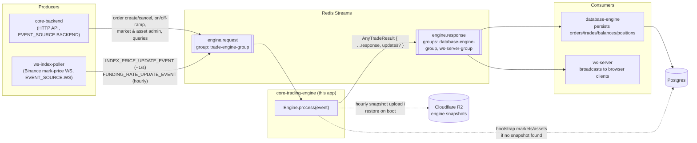

Key asymmetry: **requests are 1:1 with responses, but not every response leaves the engine.** In [`src/index.ts`](src/index.ts), if the triggering event's source is `EVENT_SOURCE.WS` (i.e. an index-price tick or funding tick, not a user action) and processing produced no `updates` bundle, the response is dropped instead of published. Index prices arrive roughly once a second per market; without this filter the response stream would be flooded with no-op messages every tick. A response is only published for a WS-sourced event when it actually changed something (a liquidation or ADL fired).

---

## 2. Engine composition

`Engine` ([`src/engine/core-engine.ts`](src/engine/core-engine.ts)) is a thin dispatcher over a set of single-purpose sub-engines that all share one mutable `EngineState` ([`src/engine/engine-state.ts`](src/engine/engine-state.ts)). Nothing here is persisted per-call — `EngineState` *is* the database, held entirely in `Map`s in process memory.

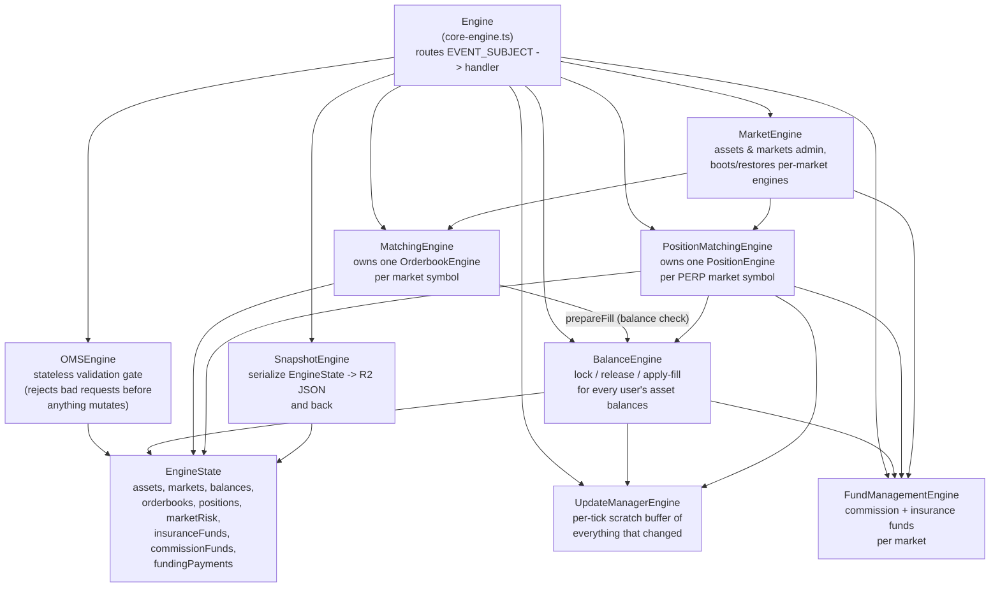

Ownership is 1:1 per market: `MatchingEngine` holds `state.orderbooks: Map<symbol, OrderbookEngine>`, `PositionMatchingEngine` holds `state.positions: Map<symbol, PositionEngine>`. Every market gets its own order book and its own position book — there is no cross-market matching or margin sharing.

---

## 3. Boot sequence & snapshots

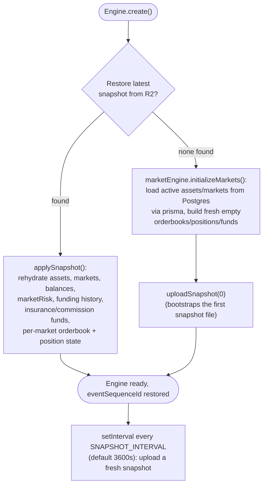

Every response also carries a monotonically increasing `eventId` (`Engine.getUpdatedEventId`) — a single global counter across *all* event types, not per-market — which restores from the snapshot's `eventSequenceId` so IDs stay strictly increasing across a restart.

---

## 4. The event loop (`Engine.process`)

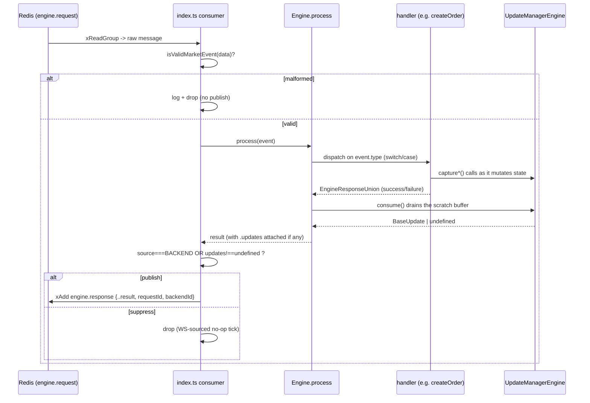

Every handler follows the same shape: validate via `OMSEngine` (pure checks, throws `RejectError`), mutate `EngineState` through the relevant sub-engine, call `updateManagerEngine.capture*` as things change, and return a typed `...EngineResponse`. If anything throws a `RejectError` anywhere in the chain, the specific handler's `catch` block rolls back what it can (order book/position snapshots, balance locks) and returns a `success:false` response with the `EVENT_REJECT_CODES` code. If something throws that *isn't* a `RejectError`, the outer `process()` catch calls `updateManagerEngine.reset()` (discarding any partial update buffer) and returns a generic `INTERNAL_ERROR`.

---

## 5. Order book internals

Each market's `OrderbookEngine` ([`src/engine/single-orderbook.ts`](src/engine/single-orderbook.ts)) is a classic price-level book:

- **Price levels**: `bids`/`asks` are `Map<price, OrderList>`, where `OrderList` ([`src/utils/order-list.ts`](src/utils/order-list.ts)) is a doubly linked list giving FIFO price-time priority within a level (O(1) append/remove).
- **Best-price lookup**: `bidTree`/`askTree` are red-black trees (`functional-red-black-tree`) keyed by price, so "best bid" (`bidTree.end`) and "best ask" (`askTree.begin`) are O(log n), and whole levels can be inserted/removed in O(log n) as they empty out or get created.
- **Direct lookup**: `orderMap: orderId -> OrderNode` for O(1) cancel/get.
- **Per-user index**: `userOrders: userId -> Set<orderId>` for listing a user's open orders and enforcing the 100-open-orders-per-user cap.

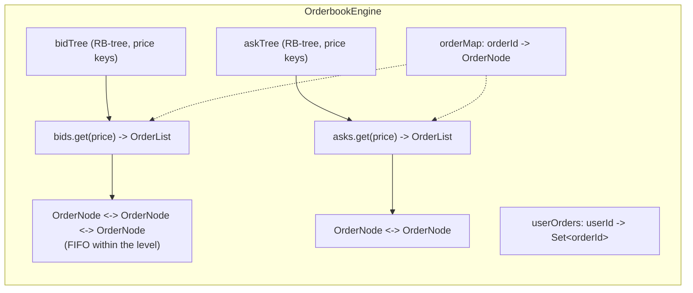

`getDepth(limit)` walks both trees (highest bid down, lowest ask up) to answer `GET_MARKET_DEPTH` REST-style queries — this is a full read, distinct from the incremental depth *deltas* streamed out per tick (see [§12](#12-deep-dive-the-update-bundle-depths-tickers-mark-price-updates-fan-out)). `getOpenInterest()` reports resting-order count + total remaining quantity + last traded price for a market; note this is book-derived ("orders currently open"), not the position-derived "aggregate open notional" that "open interest" usually means on a perp exchange — worth keeping in mind if you're consuming `GET_ONE_OPEN_INTEREST`/`GET_ALL_OPEN_INTEREST`.

---

## 6. Deep dive: Create Order

This is the central, most involved path in the engine (`Engine.createOrder` in `core-engine.ts`, delegating into `OMSEngine`, `BalanceEngine`, `MatchingEngine` → `OrderbookEngine`, and — for PERP markets — `PositionMatchingEngine`).

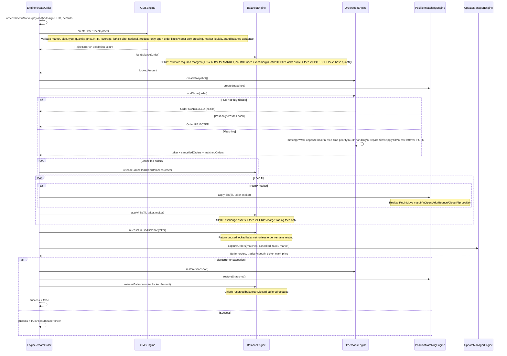

A few details worth calling out explicitly:

- **Balance is locked *before* matching, using the worst case.** For a PERP market order, the price it'll actually fill at isn't known yet, so the lock buffers 5% above the current notional/leverage estimate. Whatever isn't ultimately consumed is released at the end (`releaseUnusedBalance`).
- **Reservation is per-fill, not per-order.** During matching, `BalanceEngine.prepareFill` computes the max quantity *both* the maker and the taker can actually afford (via a lot-size-aligned binary search when the full requested quantity would overdraw either side's remaining `order.balance` allotment), and only reserves that. This is how a resting order that's slowly running low on funds gets partially — rather than fully — filled against a larger incoming order.
- **Self-trade prevention (STP)** is handled inline in `OrderbookEngine.match` via `taker.stpMode` (`CANCEL_TAKER` / `CANCEL_MAKER` / `CANCEL_BOTH`) whenever the taker and a resting maker share a `userId`.
- **PnL settlement happens before fee settlement for PERP fills** — `positionEngine.applyFills` runs first (because it needs the un-fee-adjusted fill price to compute PnL and move margin), then `balanceEngine.applyFills` charges the maker/taker fee against quote balance separately.
- **The order-book/position snapshots taken before matching are a defensive rollback net**, not the primary correctness mechanism — the primary mechanism is that `OMSEngine` rejects invalid orders *before* anything mutates. The snapshot/restore exists so that if something later in the pipeline still throws (e.g. a balance invariant violation), the book is guaranteed to come back to a known-good state rather than being left half-mutated.
- **Liquidation orders go through this exact same path.** `Engine.executeLiquidation` (see [§9](#9-deep-dive-index-price-update-liquidation--adl)) builds a synthetic reduce-only IOC market order and calls `this.createOrder(...)` directly — there is no separate liquidation matching code path.

---

## 7. Deep dive: Balances

`BalanceEngine` ([`src/engine/balance-engine.ts`](src/engine/balance-engine.ts)) tracks, per user, `Map<assetSymbol, { total, locked }>`. **Available balance is always `total - locked`.** `locked` is never a separate pool of funds — it's a portion of `total` that's earmarked and can't be spent twice.

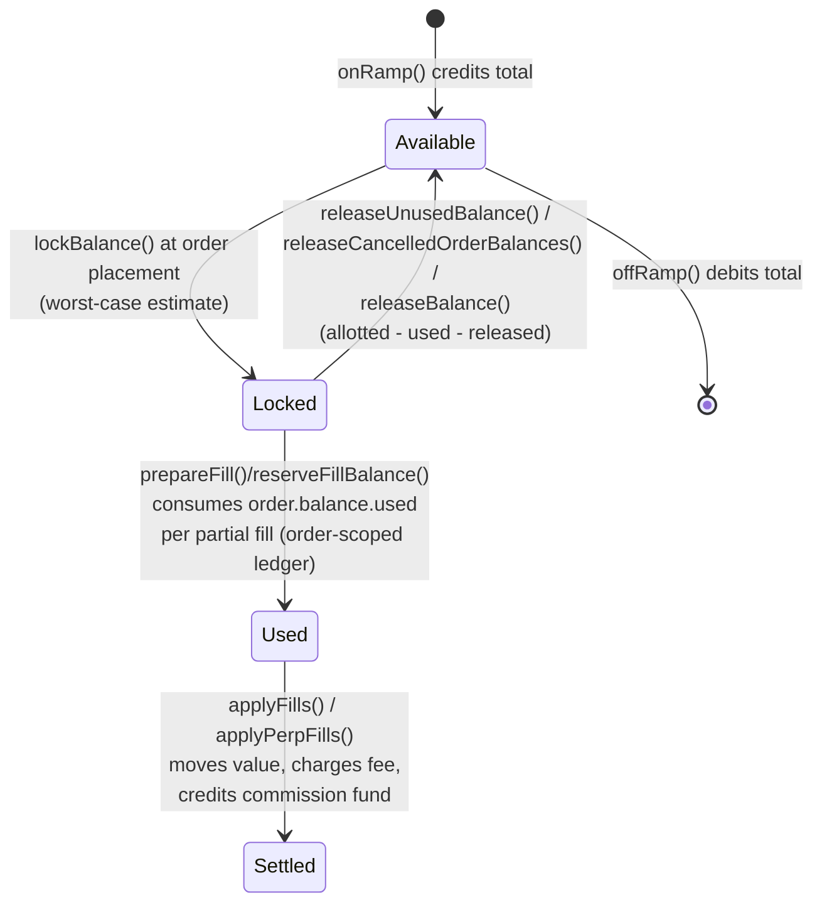

Every order carries its own tiny ledger, `order.balance = { allotted, used, released }`, so the engine can always answer "how much of what I originally locked for this specific order is still available" (`allotted - released - used`) without touching the account's aggregate `locked` figure mid-match. That per-order ledger is what `getOrderAvailableBalance`/`getFillableQty` in `BalanceEngine` operate on.

What gets locked at order-placement time, and in which asset:

| Market type | Side | Locked asset | Amount |
|---|---|---|---|
| PERP, reduceOnly | either | quote | `0` (can only shrink a position) |
| PERP, MARKET order | either | quote | `ceil(notional * 1.05 / leverage)` (slippage buffer, since fill price is unknown) |
| PERP, LIMIT order | either | quote | `ceil(notional / leverage)` |
| SPOT | BUY | quote | `notional + estimatedFee` |
| SPOT | SELL | base | `quantity` (exact — nothing to estimate) |

Trading fees are tiered: **1 bps for makers, 2 bps for takers, and a flat 50 bps for any fill flagged `liquidation: true`** (`BalanceEngine.fillFees`). Every fee collected is routed through `FundManagementEngine.addCommissionFee` (see [§11](#11-deep-dive-commission--insurance-funds)).

For PERP fills specifically, realized PnL and margin movement don't happen in `BalanceEngine` at all — they happen in `PositionEngine.applyOrderFill`, which calls back into `BalanceEngine.releasePerpCollateral` to actually apply the credit/debit. That function is also where liquidation bad debt gets absorbed by the insurance fund (`deficit` parameter) instead of leaving a user's balance negative.

---

## 8. Deep dive: Positions

`PositionEngine` ([`src/engine/single-position.ts`](src/engine/single-position.ts)) is one-per-PERP-market, and holds **one net position per user** — this is a netted book, not hedge mode: a user can't hold simultaneous long and short positions in the same market, a fill on the opposite side always nets against the existing one first.

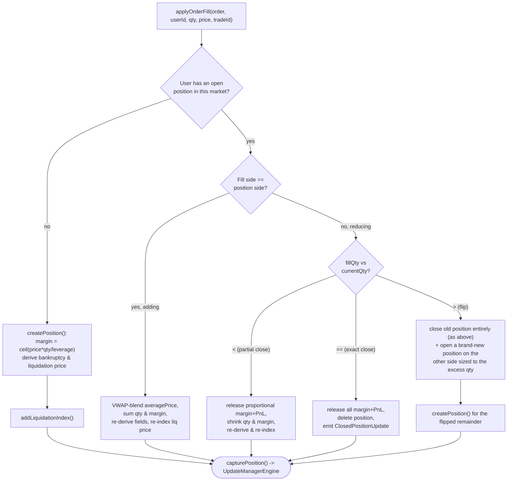

**Derived fields**, recomputed on every mutation (`updateDerivedFields`):

- `effectiveLeverage = ceil(notional / margin)`
- `bankruptcyPrice`: the price at which margin hits exactly zero — `price` moved against you by `margin / qty`
- `liquidationPrice`: `90%` of that same distance — a maintenance-margin buffer so liquidation fires *before* actual bankruptcy, leaving room for the liquidation order itself to fill

Both use `applyLossMove`: for a **long**, an adverse move is the price going *down* (`max(price - move, 0)`); for a **short**, it's the price going *up* (`price + move`).

**Liquidation index.** Every position is bucketed by its exact `liquidationPrice` into `Map<liquidationPrice, Set<positionId>>` (`longPositionBucket`/`shortPositionBucket`), with each distinct price also inserted into a red-black tree (`longPositionTree`/`shortPositionTree`). This means "which positions are liquidatable at index price X" is a single ordered range query — **all longs with `liquidationPrice >= indexPrice`, all shorts with `liquidationPrice <= indexPrice`** — instead of a scan over every open position on every price tick (`getLiquidatablePositions`). Any mutation that changes margin or quantity must remove-then-reinsert the position in this index, since its liquidation price shifts.

---

## 9. Deep dive: Index price update, liquidation & ADL

`ws-index-poller` subscribes to Binance's mark-price stream, maps Binance symbols to internal market symbols (`BTCUSDT -> BTC_PERP`, etc.), and publishes an `INDEX_PRICE_UPDATE_EVENT` (source `WS`) on essentially every tick (~1/s per market).

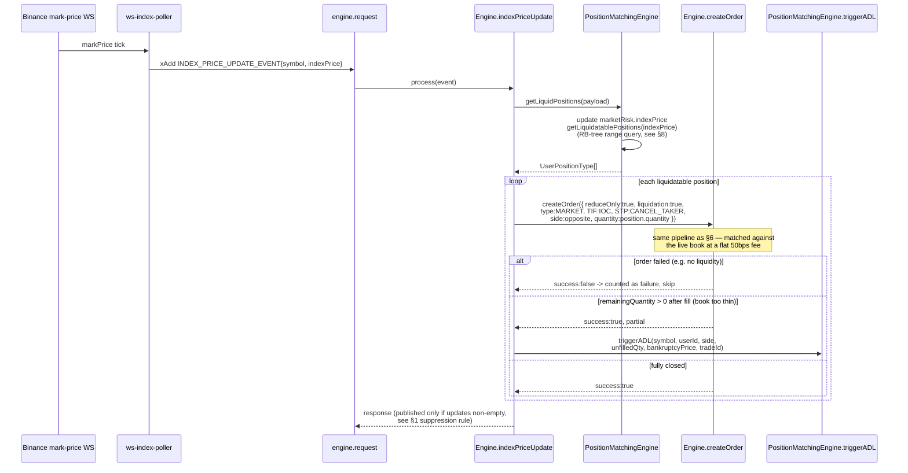

**Auto-Deleverage (ADL).** When the order book doesn't have enough opposite-side liquidity to fully close a liquidated position at the index price, the engine doesn't let it sit half-liquidated — it force-closes the most-profitable opposite-side positions directly, bypassing the order book entirely:

- `getADLCandidates(oppositeSide, referencePrice)` returns every open position on the opposite side, **sorted by descending unrealized PnL** — the traders currently most profitable against the liquidated user's side get force-closed first.
- For each candidate (skipping the liquidated user themself), a synthetic fill is applied directly via `PositionEngine.applyOrderFill` for *both* the liquidated user and the candidate, at the liquidated position's **bankruptcy price** (not the index price — this guarantees the liquidated side nets to exactly zero margin rather than manufacturing extra loss/gain), until the unfilled quantity is exhausted or candidates run out.
- If ADL still can't fully close the position (no opposite-side exposure left anywhere in the market), the shortfall is logged (`console.error`) and the position is left open, underwater, for the next price tick to retry.

Synthetic liquidation and ADL orders are tagged `liquidation: true` / `adl: true` on the resulting order/position, which surfaces downstream as `closeReason: "LIQUIDATED" | "ADL" | "CLOSED"` on the `ClosedPositionUpdate` emitted by `PositionEngine.emitClosedPosition`.

---

## 10. Deep dive: Funding settlement

`ws-index-poller` also fires a `FUNDING_RATE_UPDATE_EVENT` per known market on a `setInterval` (`FUNDING_INTERVAL_SECONDS`, default 3600s / 1h).

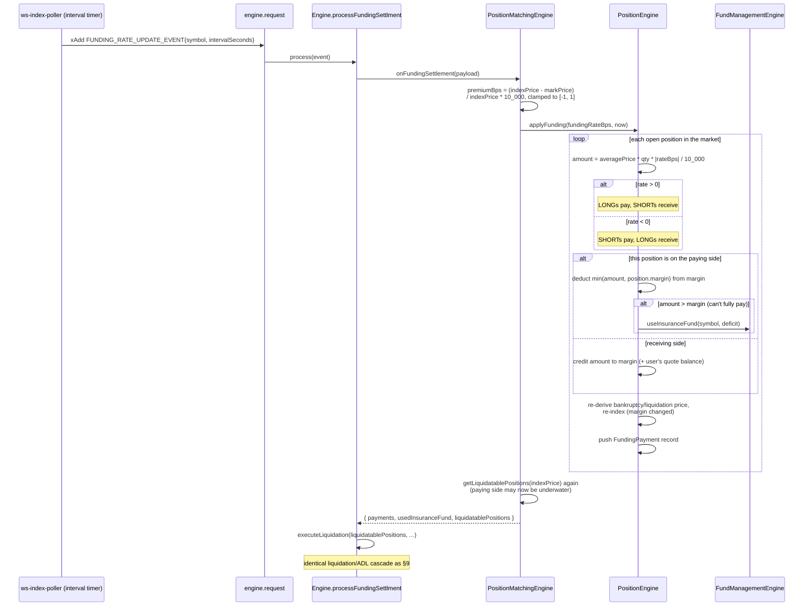

The funding rate model here is intentionally simple: it's a single point-in-time premium between mark and index price, clamped to ±1 bps per interval — not the multi-sample time-weighted average that live exchanges typically use. Every position pays/receives proportionally to its own notional (`averagePrice * quantity`), and a payer who can't fully cover their obligation from margin has the shortfall absorbed by that market's insurance fund rather than going negative. Because margin changes for every position touched, liquidation eligibility is re-checked immediately after settlement — a funding payment can itself trigger a liquidation/ADL cascade.

---

## 11. Deep dive: Commission & Insurance funds

`FundManagementEngine` ([`src/engine/fund-management-engine.ts`](src/engine/fund-management-engine.ts)) tracks two running totals **per market**: `commissionFunds` (house revenue) and `insuranceFunds` (loss-absorption buffer).

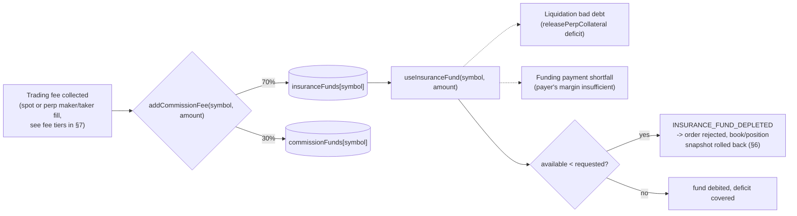

**Every trading fee is split 70% to insurance / 30% to commission** — the insurance fund is not a separate deposit, it's funded passively out of ordinary trading activity, and gets drawn down during liquidation cascades or funding shortfalls. If a liquidation's bad debt would exceed what the insurance fund can currently cover, `BalanceEngine.releasePerpCollateral` rejects with `INSURANCE_FUND_DEPLETED` *before* debiting anything — the synthetic liquidation order then fails in `createOrder`, its book/position mutations are rolled back via the snapshot mechanism (§6), and the still-underwater position is left for a later price tick / ADL pass.

Every change to either fund is captured via `UpdateManagerEngine.captureCommission(symbol, commissionFund, insuranceFund)`, which is how `commissions` shows up in the outbound update bundle (§12).

---

## 12. Deep dive: the update bundle (depths, tickers, mark price, updates fan-out)

`UpdateManagerEngine` ([`src/engine/update-manager-engine.ts`](src/engine/update-manager-engine.ts)) is a per-event scratch buffer, not persistent state. Every sub-engine calls one of its `capture*` methods as it mutates `EngineState`; at the very end of `Engine.process`, `consume()` drains everything captured into a single `BaseUpdate` object, attaches it to the response as `.updates`, and clears the buffer for the next event. On any thrown error, `reset()` is called instead — discarding whatever was captured, so a failed request can never leak a partial update downstream.

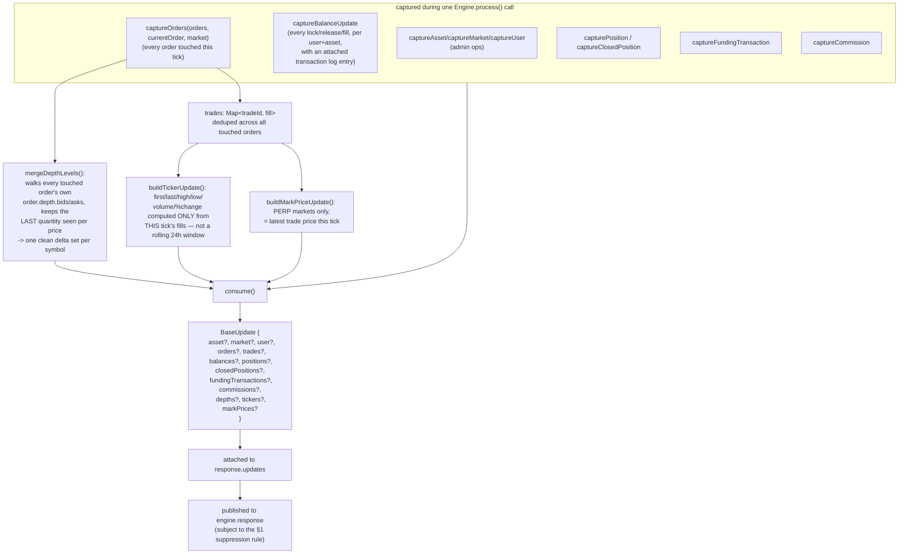

Two things worth being precise about, since they're easy to misread from the field names alone:

- **`tickers` is per-tick, not rolling.** `buildTickerUpdate` computes first/last/high/low/volume/priceChange purely from the trades generated by *this specific event* (e.g. the fills from one `createOrder` call). It is not a maintained 24h rolling ticker — a consumer wanting a rolling ticker needs to aggregate these increments itself.
- **`depths` is a delta, not a snapshot.** It only contains the price levels actually touched by orders in this tick, each carrying the *resulting* quantity at that level (`0` means the level emptied out and should be removed downstream). A consumer needing the full book state uses `GET_MARKET_DEPTH` (§5) to seed itself once, then applies these deltas.

`discardBalanceUpdates()` is a narrower version of `reset()`, used specifically by `BalanceEngine.releaseBalance` when an order is rolled back after its initial lock succeeded — it wipes only the buffered balance-transaction log for that failed call, since a rolled-back order should never appear to have moved anyone's balance.

---

## 13. Event catalog

Every `EVENT_SUBJECT` the engine's `process()` switch handles (`@workspace/shared`):

| Subject | Handler | Mutates state? |
|---|---|---|
| `engine.heath.check` | `healtCheck` | no |
| `engine.asset.add` / `.update` / `.delete` | `addAsset` / `updateAsset` / `deleteAsset` | yes (admin) |
| `engine.market.add` / `.update` / `.delete` | `addMarket` / `updateMarket` / `deleteMarket` | yes (admin) |
| `engine.user.add` | `addUser` | yes |
| `engine.balance.get` | `getUserBalances` | no |
| `engine.balance.onramp` / `.offramp` | `onRampBalance` / `offRampBalance` | yes |
| `engine.order.create` | `createOrder` | yes — see [§6](#6-deep-dive-create-order) |
| `engine.order.cancel` | `cancelOrder` | yes |
| `engine.order.open.one` / `.all` | `getOneOpenOrder` / `getAllOpenOrder` | no |
| `engine.order.open.delete` | `deleteAllOpenOrder` | yes (cancels every open order for a user in a market) |
| `engine.depth.get` | `getMarketDepth` | no |
| `engine.indexprice.update` | `indexPriceUpdate` | yes — see [§9](#9-deep-dive-index-price-update-liquidation--adl) |
| `engine.fundingrate.update` | `processFundingSettlment` | yes — see [§10](#10-deep-dive-funding-settlement) |
| `engine.marketrisk.get.one` / `engine.markprice.get.all` | `getOneMarketRisk` / `getAllMarketRisk` | no |
| `engine.openinterest.get.one` / `.all` | `getOneMarketOpenInterest` / `getAllMarketOpenInterest` | no |

---

## 14. Error handling

All rejections are typed via `EVENT_REJECT_CODES` (`@workspace/shared/types/engine.ts`) and thrown as `RejectError` (`src/utils/error.ts`), caught at the handler level and turned into a `success: false` response carrying `rejectCode` + a human-readable `message`. Validation codes are almost entirely produced by `OMSEngine` (`src/engine/oms-engine.ts`), which is deliberately kept stateless-and-pure — it only *reads* `EngineState` to check constraints, it never mutates. This means every `createOrderCheck`/`cancelOrderCheck` failure is guaranteed to happen before any balance lock, book mutation, or update is captured, so the common-case rejection path (bad input) never needs a rollback at all — rollback (§6's snapshot/restore) only exists for failures that occur *after* mutation has already started.
